<div align="center">



<br>


</div>

## Web builder

**[Open the builder](https://0xrcph.github.io/cs2-config/)** to make your own configs in the browser, nothing is uploaded:

- **Crosshair** with a live preview, presets and copy-paste console commands
- **Autoexec** with toggles for radar, viewmodel and quality of life, downloadable as `autoexec.cfg`
- **Practice** config builder for offline grenade and aim practice
- **Launch options** generator for Steam

## What's inside

| File | Use it for |
|:--|:--|
| [`autoexec.cfg`](autoexec.cfg) | Everyday settings: radar, viewmodel options, quality of life. Safe for matchmaking. |
| [`practice.cfg`](practice.cfg) | **Offline only.** Infinite money, grenade trajectory preview, frozen bots, noclip, rethrow your last nade. |

## Install

1. Download this repo (green **Code** button, then **Download ZIP**).
2. Copy both `.cfg` files into:
   ```
   <Steam>\steamapps\common\Counter-Strike Global Offensive\game\csgo\cfg\
   ```
3. In Steam, right-click **Counter-Strike 2**, open **Properties**, and add this to **Launch Options**:
   ```
   +exec autoexec
   ```
4. For practice, start a local match with bots or a workshop map, open the console (`~`) and run:
   ```
   exec practice
   ```

## Practice keys

| Key | Does |
|:-:|:--|
| `N` | noclip, fly through the map |
| `K` | rethrow your last grenade |
| `L` | refill money and ammo |
| `O` | reload the practice config |

Console aliases: `rr` restarts the round, `bots` respawns bots, `freeze` / `unfreeze` toggles bot movement.

## Notes

- `practice.cfg` turns on `sv_cheats`. It only works on your own local server and will not work on official servers.
- Console commands change with game updates. If one errors in the console, delete that line and open an issue or PR.
- This pack is **untested on the latest build**. Try it in a practice match before relying on it.
- Not affiliated with or endorsed by Valve. Counter-Strike is a trademark of Valve Corporation.

Suggestions and fixes welcome, open an issue or a PR.

<div align="center">

made by [0xrcph](https://github.com/0xrcph)

</div>
